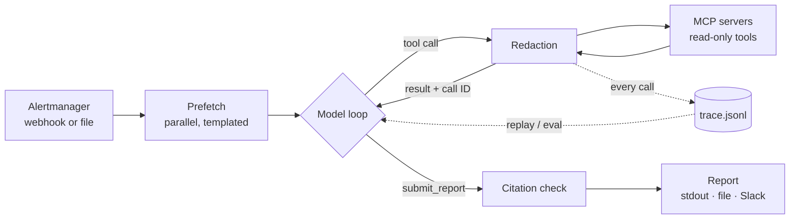

<div align="center">


# Hindcast

**The open-source incident investigation agent you can replay, measure, and run entirely on your own infrastructure.**

An alert fires. Hindcast investigates it with an LLM and read-only tools, cites the evidence for its answer,<br>
and records every step, so the investigation can be replayed against another model and graded.

[](https://github.com/DushaneW/Hindcast/actions/workflows/ci.yml)
[](https://github.com/DushaneW/Hindcast/releases)
[](https://pkg.go.dev/github.com/DushaneW/Hindcast)
[](LICENSE)

[Install](#install) · [Quickstart](#quickstart) · [How it works](#how-it-works) · [Alertmanager](#run-as-an-alertmanager-receiver) · [Replay and eval](#replay-and-eval) · [Safety](#safety) · [Roadmap](#roadmap)

</div>

---

> **Status: early.** Recording, replay, eval, the webhook server, Slack
> delivery, redaction and the read-only policy have been run against a live
> k3s cluster through
> [kubernetes-mcp-server](https://github.com/containers/kubernetes-mcp-server).
> The model in those runs was a scripted stand-in. No real model has been
> evaluated yet, so this README contains no accuracy or speed numbers.

## Why Hindcast

Most AI SRE agents can be demoed but not evaluated. An investigation queries
live systems, so it cannot be repeated, compared across models, or turned into
a regression test. Hindcast is built around fixing that.

| Property | What it means |
|---|---|
| **Replayable** | Every investigation is written to a JSON Lines trace: the alert, the tools offered, each call with its full result, and the report. `hindcast replay` re-runs it against the recording, so you can try another model or prompt on a real incident without touching production. |
| **Measured** | `hindcast eval` replays a directory of recorded incidents and grades each report, by regexp or by a judge model. CI runs it on every change. |
| **Read-only by default** | A tool reaches the model only if its MCP server marks it read-only, or you allow it by name. Against kubernetes-mcp-server this hides `pods_delete`, `pods_exec`, `pods_run`, `resources_create_or_update`, `resources_delete` and `resources_scale`. |
| **Private by default** | No account, no hosted service, no telemetry. Credentials in tool output are masked before the model or the trace sees them. |
| **Evidence you can check** | Every finding cites the call it came from. Citations of calls that never happened are dropped, and a confident answer with no valid citation is downgraded to low confidence. |
| **Small core** | One static Go binary with two dependencies (the MCP SDK and a YAML parser). Integrations are MCP servers, not vendor SDKs compiled in. |
| **Any model** | Any OpenAI-compatible endpoint (OpenAI, Gemini, OpenRouter, Groq, Ollama, vLLM) or Anthropic's native API. |

## Install

**macOS and Linux**

```sh
curl -fsSL https://raw.githubusercontent.com/DushaneW/Hindcast/main/install.sh | sh
```

**Windows (PowerShell)**

```powershell
irm https://raw.githubusercontent.com/DushaneW/Hindcast/main/install.ps1 | iex
```

Both installers download the release archive for your platform, verify its
SHA-256 checksum, and install a single binary. No sudo, nothing else changed.

**Docker**

```sh
docker run --rm -v "$PWD/hindcast.yaml:/etc/hindcast/hindcast.yaml" -p 9095:9095 \
  -e HINDCAST_API_KEY -e HINDCAST_WEBHOOK_TOKEN ghcr.io/dushanew/hindcast
```

The image includes Node.js, because most MCP servers are started with `npx`.

**From source** (Go 1.25+)

```sh
go install github.com/DushaneW/Hindcast/cmd/hindcast@latest
```

## Quickstart

Copy the example config and point it at your model and MCP servers:

```sh
curl -fsSLO https://raw.githubusercontent.com/DushaneW/Hindcast/main/hindcast.example.yaml
mv hindcast.example.yaml hindcast.yaml
export HINDCAST_API_KEY=...        # key for the provider named in hindcast.yaml
hindcast tools                     # what the model may use, and what is hidden
```

```
offered:
  k8s__events_list
  k8s__pods_get
  k8s__pods_list_in_namespace
  k8s__pods_log
  ...
hidden (not marked read-only; add to the server's allow list to offer):
  k8s__pods_delete
  k8s__pods_exec
  k8s__pods_run
  k8s__resources_create_or_update
  k8s__resources_delete
  k8s__resources_scale
```

Investigate an alert:

```sh
hindcast investigate -alert alert.json
```

The report below is from the live k3s test run. The model there was a
scripted stand-in, so the wording is not a model's; the format, the cited
calls and the numbers are real.

```markdown
# KubeDeploymentReplicasMismatch

**Root cause** (medium confidence): pod sandbox creation fails in the container runtime

## Evidence

- `c1` k8s__events_list: FailedCreatePodSandBox events
- `c3` k8s__pods_get: pod stuck in ContainerCreating

---
2 steps, 3 tool calls, 2 input / 2 output tokens, 33ms
```

## How it works



1. **Prefetch.** Calls you configure, templated from the alert's labels and
   start time, run in parallel before the model's first turn. The context
   every alert needs arrives in one round trip instead of several model turns.
2. **Investigate.** The model calls tools until it submits a report. Calls in
   one turn run concurrently. Each result is tagged with a call ID such as
   `[call c3]`, which the model cites as evidence. Long results are clipped
   for the model and kept whole in the trace.
3. **Validate.** The report is checked against the calls actually made.
   Invalid reports are sent back to the model to fix.
4. **Deliver.** The report goes to stdout, to a Markdown file next to the
   trace, and to Slack if configured.

## Commands

| Command | What it does |
|---|---|
| `hindcast investigate` | Investigate one Alertmanager payload from a file or stdin. Writes the trace and report to `./hindcast-traces/`. |
| `hindcast serve` | Receive Alertmanager webhooks on `POST /alerts` and investigate in the background. |
| `hindcast replay <trace>` | Re-run a recorded investigation against its recorded tool results. |
| `hindcast eval <dir>` | Replay every scenario in a directory and grade the reports. Exits 1 if any fail. |
| `hindcast tools` | List the tools the read-only policy offers and hides. |
| `hindcast version` | Print the version. |

## Run as an Alertmanager receiver

```sh
export HINDCAST_WEBHOOK_TOKEN=$(openssl rand -hex 32)
hindcast serve -addr :9095
```

```yaml
# alertmanager.yml
receivers:
  - name: hindcast
    webhook_configs:
      - url: http://hindcast:9095/alerts
        send_resolved: false
        http_config:
          authorization:
            credentials_file: /etc/alertmanager/hindcast-token
```

- Each alert group is investigated once. Repeats while it is queued or
  running, or within `-cooldown` (default 1h) after it finished, are
  acknowledged and dropped.
- At most `-workers` investigations run at once (default 2). When the queue is
  full the server answers 503 and Alertmanager retries.
- Without `HINDCAST_WEBHOOK_TOKEN`, anyone who can reach the port can start an
  investigation; the server warns about this at startup.

## Configuration

Everything lives in `hindcast.yaml`; see
[hindcast.example.yaml](hindcast.example.yaml) for a complete file.

| Key | Purpose |
|---|---|
| `model` | `provider: openai` for any OpenAI-compatible endpoint, or `anthropic`. `api_key_env` names the variable holding the key; keys never go in the file. |
| `servers` | MCP servers started over stdio. `allow` offers named tools that are not marked read-only. |
| `prefetch` | Calls made for every alert. String arguments are Go templates: `{{.Labels.namespace}}`, `{{rfc3339 (before .StartsAt "30m")}}`. |
| `budget` | `max_steps`, `max_tokens`, `tool_timeout`, `max_result_bytes`. |
| `redact` | Extra regexps to mask; `disable_builtin` turns off the built-in rules. |
| `notify.slack` | `webhook_url_env` names the variable holding a Slack incoming webhook URL. |
| `judge` | A model that grades eval results against scenario references. |

## Replay and eval

A scenario is a directory with a recorded `trace.jsonl` and a `scenario.yaml`:

```yaml
description: Pods OOMKilled after a deploy lowered the memory limit
expect:
  reference: A commit cut the memory limit from 512Mi to 256Mi; the service needs ~400Mi.
  root_cause: ["memory limit", "512Mi.*256Mi"]   # regexps, case-insensitive; one must match
  cites: [k8s__events_list]                      # tools the evidence must cite
```

```sh
hindcast replay hindcast-traces/20261120T030012Z-KubePodCrashLooping.jsonl
hindcast eval scenarios/
```

With a `judge` in the config, root causes are graded against `reference` by
that model instead of the regexps.

Know what the grades mean:

- Regexps reject correct answers phrased differently and accept wrong ones
  that use the right words.
- A judge is a model with its own errors. Check a sample of its verdicts by
  hand, use a different model from the one under test, and report which
  model judged.
- When a replayed model calls a tool with arguments that were not recorded,
  it is told which argument sets were. That keeps replay usable across
  models, but it makes eval easier than the live task.
- Three of the four shipped scenarios are hand-written and synthetic;
  `k3s-sandbox-failure` was recorded from a live cluster. They test the
  pipeline, not model quality. Real, anonymised traces are the most useful
  contribution this project can get.

## Safety

- **Read-only policy.** Tools are offered only if the MCP server annotates
  them `readOnlyHint`, or you list them in `allow`. The policy trusts the
  server's annotations, so also run servers with credentials that cannot
  write.
- **Redaction.** Built-in rules mask private keys; AWS, GitHub, Slack and
  `sk-` API keys; JWTs; bearer tokens; passwords in URLs; `KEY=value` pairs
  and Kubernetes `name:`/`value:` env entries whose key ends in password,
  secret, token or api key. Values with no recognisable shape, such as Secret
  data under a neutral key name, are not caught. Do not give Hindcast
  credentials that can read Secrets.
- **No outbound data** except to the model provider you configure, the MCP
  servers you start, and Slack if you enable it.

See [SECURITY.md](SECURITY.md) to report a vulnerability.


| Hindcast |
|---|---|---|
| Account required | Interactive shell opens only for a signed-in account | No account |
| Telemetry | Product analytics and Sentry, on by default (opt-out) | None |
| Integrations | 60+ built in; their SDKs are core dependencies | Any MCP server you choose |
| Language and size | Python, about 160k lines | Go, about 3k lines |
| Replay without production access | Not found | `hindcast replay` |
| Published quality results | Not found | Eval harness in CI; real-model results not yet published |
| Write actions | Can push fixes and run remediation | None; read-only by design |
| License | Apache 2.0 | Apache 2.0 |

OpenSRE does more today: CI/CD failure analysis, pushing fixes, a hosted
gateway, and many built-in integrations and chat surfaces. Hindcast is
narrower on purpose: it does investigation, and it makes the quality of that
investigation something you can measure.

## Project layout

```
cmd/hindcast/          CLI: investigate, serve, replay, eval, tools
internal/investigate/  prefetch, the model loop, report validation
internal/trace/        JSONL trace format and the replaying tool box
internal/mcpbox/       MCP sessions and the read-only policy
internal/redact/       credential masking
internal/llm/          OpenAI-compatible and Anthropic clients
internal/eval/         scenarios, regexp and judge grading
internal/server/       webhook endpoint, queue, dedupe
internal/notify/       Slack
scenarios/             recorded incidents used by eval
```

Design notes: [docs/design.md](docs/design.md).

## Roadmap

- [ ] Publish eval results for several models on every release
- [ ] More recorded scenarios from real incidents
- [ ] Prefetch recipes for Prometheus, Loki and GitHub MCP servers
- [ ] GitHub issue and PagerDuty output
- [ ] MCP servers over HTTP

## Contributing

```sh
make lint test
```

The most valuable contributions are recorded, anonymised incident traces with
a `scenario.yaml` describing the real root cause. See
[CONTRIBUTING.md](CONTRIBUTING.md).

## License

[Apache 2.0](LICENSE)
